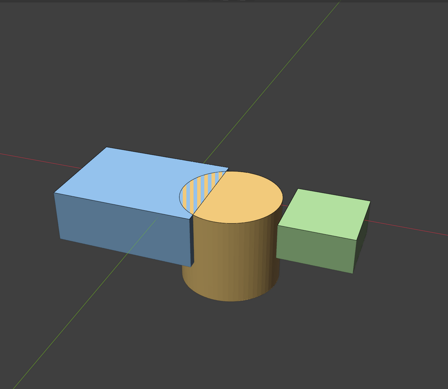
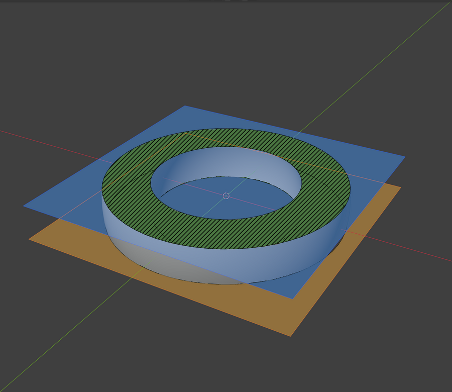
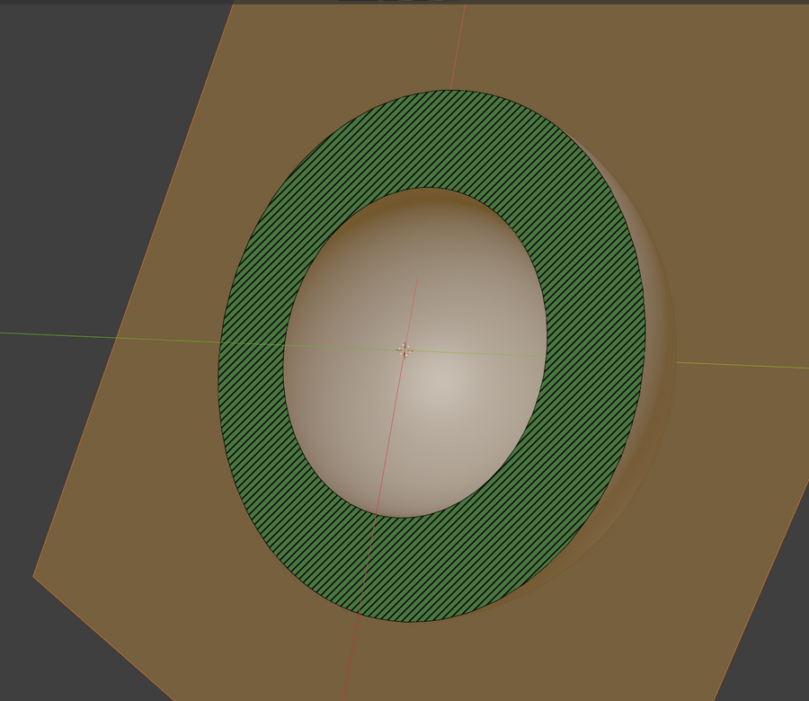

# Crosscut

Live, non-destructive **section** and **slice** views for Blender's 3D viewport.

Blender's clipping region (Alt+B) shows you the backfaces of whatever it cuts. Crosscut
uses the same viewport clip planes and adds **caps**: the cut is filled (and optionally
hatched) wherever the plane passes through solid material, so a cut part reads as a solid
cross-section, the way section views work in CAD. One click switches back to the plain
backface look.

| Backfaces (plain Alt+B) | Hatched section | Slice |
|---|---|---|
|  |  |  |

*Blender 5.2 screenshots made by [`tools/showcase.py`](tools/showcase.py). The look comes from
the maintainer's hand-made mock-ups in [docs/images/reference/](docs/images/reference/).*

## Features

- **Section** (keep one side) or **Slice** (only the cross-section, or a slab of any thickness).
- **Planes** along X, Y, Z, an object's local Z (an Empty you move with G/R, or the part
  itself), or **View**: facing the view as it is when you click, and staying put when you orbit.
- **Cap styles**: Backfaces (native look), Solid, Hatched. They apply to Section, Slice and
  Blender's own Alt+B box alike; Backfaces turns capping off everywhere.
- **Scrub** the plane across the parts, or across any object's bounds (for example a build
  volume), as a 0-1 slider or as a distance. Step buttons and **Shift+Alt+Wheel** move it by a
  fixed step (default 0.08, one MJF layer at 1 unit = 1 mm); add Ctrl for 10 steps.
- **Several parts**: hatching alternates per part (ISO 128-50 style); where sections overlap,
  an adjustable interference highlight (red cross-hatching by default), and underneath it the
  overlapping caps either blend their colours or share the area in stripes.
- **Plane display**: frame, tint or hatching, in colours you choose; a slab's two planes get
  different colours.
- **Open meshes** are outlined in orange and named in the viewport readout; their gaps are
  closed so the fill still makes sense.
- **Selectable in a zero-thickness slice**: click a section to select its part.
- Colours follow the Solid shading colour (Object or Material); white or grey parts get the Cap
  Color (green by default) so the cut stands out.
- **Fast and non-destructive**: the mesh/plane intersection is cached and only recomputed when
  the plane or the mesh changes; nothing is added to or changed in your meshes.

| Several parts with interference | Overlap as stripes | Scrub range from a build volume |
|---|---|---|
|  |  |  |

| Slab with tinted planes | View plane, orbited after setting it | The panel |
|---|---|---|
|  |  |  |

## Install

Blender 4.2 or newer. Download `crosscut-<version>.zip` from
[Releases](https://github.com/calvin-young/blender-crosscut/releases), then in Blender:
Edit > Preferences > Get Extensions > (menu, top right) > Install from Disk.

## Use

Open the sidebar (N) > **Crosscut**, click **Section** or **Slice**, drag **Scrub**. The full
walk-through is in the [user guide](docs/USER_GUIDE.md).

| Where | What |
|---|---|
| Sidebar (N) > Crosscut | Section / Slice, cap style, plane, scrub; everything else in Settings below (closed) |
| **Shift+Alt+B** (3D View) | Pie: Section X / Y / Z, On/Off, Backfaces/Caps, Section/Slice, Flip, Section from View |
| Header button (right) | Toggle on/off, popover with the main controls |
| **Shift+Alt+Wheel** | Step the plane (Ctrl for x10) while Crosscut is on |

Caps show in **Solid** shading; Wireframe is clipped but not capped, and Blender does not clip
Material Preview or Rendered views. Objects displayed as Wire or Bounds and the scrub range
object are never capped (the readout lists them), so a build-volume box does not fill the
whole section.

## How it works

1. The plane(s) go into the view's `RegionView3D.clip_planes`, exactly the planes Alt+B sets, so
   everything (including selection) is clipped by Blender itself.
2. For each target, the evaluated mesh is intersected with the plane in numpy. Shared edges are
   evaluated in a canonical order, so the result is watertight even for unwelded STL-style
   meshes.
3. Each segment becomes a fan triangle from a common apex. Drawn into an offscreen mask with
   invert blending, a pixel flips each time it is covered and ends up lit exactly when it is
   inside the section (even-odd rule): holes and islands work without any triangulation or
   contour chaining.
4. A quad on the plane is drawn with the scene's depth buffer, keeping only lit mask pixels, and
   paints the fill and hatching. Further offscreens count overlaps, for blending, stripes and
   the interference highlight.

### Alternatives considered

| Approach | Pros | Cons |
|---|---|---|
| **Clip planes + GPU caps (Crosscut)** | Live, non-destructive, Solid mode, exact section, interference | Needs closed meshes for clean caps; Solid/Wireframe only |
| Backface tint shader (material override) | Very cheap | Material Preview only, relies on normals, cannot show overlap or a section-only slice |
| Live boolean / bisect modifiers | Real geometry, renders anywhere | Slow on dense meshes, modifies the object stack |
| CPU contour triangulation | Real cap mesh, exportable | Chaining and hole handling are fragile on messy meshes; slower to scrub |

## Status

**1.0 release candidate (0.9.1).** 0.1.0 was written without access to Blender; since 0.2.0
every build is run and tested in Blender with an automated in-viewport test suite
([`tests/blender/`](tests/blender/run_viewport_tests.py)), and 0.3.0 to 0.9.0 followed the
maintainer's tests on real parts. Tested on Blender 4.2.23 LTS and 5.2.3 LTS (Linux, OpenGL;
5.2 also on Vulkan). Not yet tested on macOS or Windows. Changes are listed in
[CHANGELOG.md](CHANGELOG.md).

The project is developed almost entirely by an AI assistant (Claude) with minimal human code
review; the maintainer sets the direction, tests each build on real work and reviews the
behaviour and UI/UX. See [docs/PROMPT_STATS.md](docs/PROMPT_STATS.md) for how much human
steering went into it.

## Contributing

See [AGENTS.md](AGENTS.md) for setup, tests and layout, [CONTRIBUTING.md](CONTRIBUTING.md) for
how to report bugs and send changes, and [docs/DECISIONS.md](docs/DECISIONS.md) for why things
are built this way. Bugs and plans are in [Issues](https://github.com/calvin-young/blender-crosscut/issues).

## License

GPL-3.0-or-later, see [LICENSE](LICENSE).
