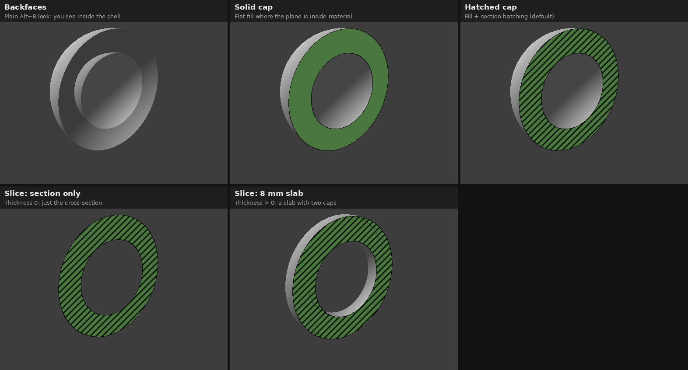
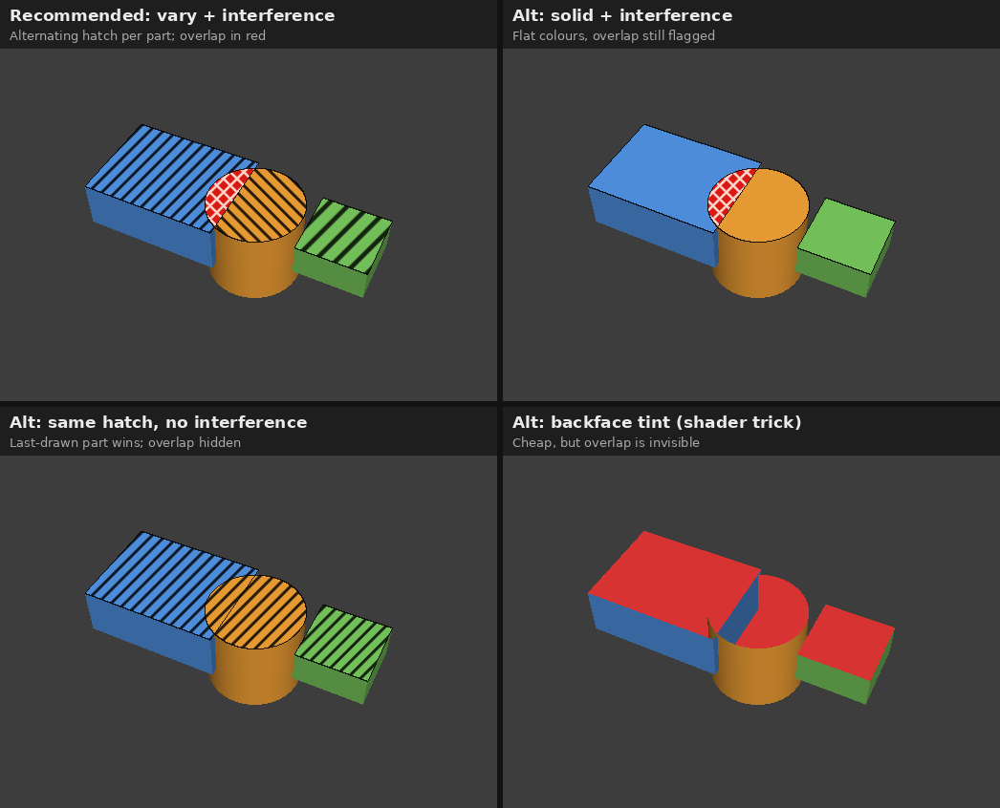

# Crosscut

Live, non-destructive **section** and **slice** views for Blender's 3D viewport.

Blender's clipping region (Alt+B) shows you the backfaces of whatever it cuts. Crosscut
uses the same viewport clip planes and adds **caps**: the cut is filled (and optionally
hatched) wherever the plane passes through solid material, so a cut part reads as a solid
cross-section, the way section views work in CAD. One key toggles back to the plain
backface look.

*Concept renders made outside Blender to compare the options. Run
[`tools/showcase.py`](tools/showcase.py) in Blender for real screenshots. The look it aims for
comes from the maintainer's hand-made mock-ups in [docs/images/reference/](docs/images/reference/).*

## Features

- **Section**: cut along X, Y, Z or any plane (an Empty you place with G/R or align to the view).
- **Slice**: show only the cross-section (thickness 0) or a slab of any thickness.
- **Cap styles**: Backfaces (native look), Solid, Hatched. Toggle Backfaces/caps from the pie,
  the panel or the header button.
- **Scrub**: drag a slider to sweep the plane across the targets' bounds, or across any
  object's bounds (for example a build volume). Step buttons and **Shift+Alt+Wheel** move it by
  a fixed step (default 0.08, one MJF layer at 1 unit = 1 mm); add Ctrl for 10 steps.
- **Several bodies**: hatch direction then spacing alternates per object (ISO 128-50 style), and
  where two or more objects' sections overlap the overlap is cross-hatched in red
  (interference).
- **Watertightness hint**: an open (non-manifold) section is outlined in orange and listed in the
  viewport readout.
- **Works with Alt+B**: Blender's own clipping box gets caps too. Pressing Alt+B while Crosscut
  is active hands clipping back to Blender (and turns Crosscut off).
- Colours follow the Solid shading colour (Object or Material), or use a per-object palette or
  a single colour.
- Caps are drawn on the GPU every frame; the mesh/plane intersection is cached and only
  recomputed when the plane or the mesh changes (about 30 ms for a 1M-triangle mesh in numpy).
  Nothing is added to or changed in your meshes.

## Install

Blender 4.2 or newer. Edit > Preferences > Get Extensions > (menu) > Install from Disk, pick
`crosscut-<version>.zip`.

## Use

| Where | What |
|---|---|
| **Shift+Alt+B** (3D View) | Pie: Section X / Y / Z, Off, Backfaces/Caps, Section/Slice, Flip, Plane from View |
| Header button (right) | Toggle on/off, popover with the main controls |
| Sidebar (N) > Crosscut | All settings |
| **Shift+Alt+Wheel** | Step the plane (Ctrl for x10) while Crosscut is on |

Clipping and caps show in **Solid** and **Wireframe** shading (Blender does not clip Material
Preview or Rendered views). Objects displayed as Wire or Bounds, the plane object and the range
object are never capped, so a build-volume box does not fill the whole section.

## How it works

1. The plane(s) go into the view's `RegionView3D.clip_planes`, exactly the planes Alt+B sets, so
   everything (including selection) is clipped by Blender itself.
2. For each target, the evaluated mesh is intersected with the plane in numpy. Shared edges are
   evaluated in a canonical order, so the result is watertight even for unwelded STL-style
   meshes.
3. Each segment becomes a fan triangle from a common apex. Drawn into an offscreen mask with
   invert blending, a pixel flips each time it is covered and ends up lit exactly when it is
   inside the section (even-odd rule): holes and islands work without any triangulation or
   contour chaining.
4. A quad on the plane is drawn with the scene's depth buffer, keeping only lit mask pixels, and
   paints the fill and hatching. A second offscreen counts overlaps for interference.

### Alternatives considered

| Approach | Pros | Cons |
|---|---|---|
| **Clip planes + GPU caps (Crosscut)** | Live, non-destructive, Solid mode, exact section, interference | Needs closed meshes for clean caps; Solid/Wireframe only |
| Backface tint shader (material override) | Very cheap | Material Preview only, relies on normals, cannot show overlap or a section-only slice |
| Live boolean / bisect modifiers | Real geometry, renders anywhere | Slow on dense meshes, modifies the object stack |
| CPU contour triangulation | Real cap mesh, exportable | Chaining and hole handling are fragile on messy meshes; slower to scrub |

## Development

See [AGENTS.md](AGENTS.md) for setup, tests and layout, [CONTRIBUTING.md](CONTRIBUTING.md) for
how to report bugs and send changes, and [docs/DECISIONS.md](docs/DECISIONS.md) for why things
are built this way. The roadmap will live in [Issues](../../issues).

## Status and disclosure

**Experimental (0.1.0).** This first build was written without access to Blender and has known
bugs from its first real test; a tested build is next. Expect rough edges.

The project is developed almost entirely by an AI assistant (Claude) with minimal human code
review; the maintainer sets the direction, tests each build on real work and reviews the
behaviour and UI/UX. See [docs/PROMPT_STATS.md](docs/PROMPT_STATS.md) for how much human
steering went into it.

## License

GPL-3.0-or-later.
