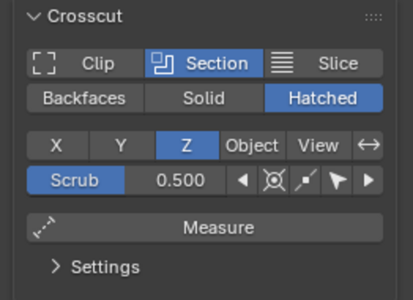

# Crosscut user guide

Crosscut clips the 3D viewport with a plane and fills the cut faces, so clipped parts read as
solid. It uses the same viewport clipping as Blender's clipping region, so selection, snapping and
everything else in the view respect the clipping. Nothing in your file changes except Crosscut's
own settings, which save with the scene.

Units below assume 1 Blender unit = 1 mm, but Crosscut works in any unit.

## Quick start

1. Open the sidebar (N) and pick the **Crosscut** tab. (The panel can live elsewhere: see Where the panel is.)
2. Click **Section**. The plane starts in the middle of your parts and clips away the half
   facing you.
3. Drag **Scrub** to sweep the plane through the parts.
4. Click **Section** again to turn it off.

## The main panel

### Section and Slice

- **Section** keeps one side of the plane: a half section.
- **Slice** keeps only what is near the plane. With **Slice Thickness** 0 (Clipping Plane) you see just the
  cross-section itself; with a thickness you see a slab, centred on the plane.
- **Clip** is Blender's own clipping region, with filled cut faces (see below). The button is lit while the view
  has a box. Click it to turn Section or Slice off and bring back the box they replaced, or draw a new
  one; click it when lit to remove the box.

Clicking a lit Section or Slice turns Crosscut off. Turning it off removes all clipping from the
view, including a clipping region that was there before. With everything off, **X**, **Y**, **Z**,
**Object** and **View** each start the plane they name, in the last mode you used. Clicking the lit one
turns it off again.

### Fill

- **Backfaces**: no fill, the plain clipping look. A zero-thickness slice still shows the
  section, in the theme's backface colour, since otherwise there would be nothing to see.
- **Solid**: the cut faces are filled with a flat colour.
- **Hatched**: filled and hatched, like a section drawing.

The fill applies to Clip, Section and Slice alike.

### Plane

- **X / Y / Z**: the plane is perpendicular to that world axis.
- **Object**: the plane is perpendicular to one of the chosen object's local axes (**X**, **Y**
  or **Z** in the row below, Z by default), through its origin. Move and rotate the object to
  move the plane. When you choose Object it picks the only visible Empty, else the selected
  object, else the only visible object; if the chosen object has since been hidden or deleted,
  choosing Object picks again. **+** adds an Empty facing the view. Nothing is clipped until an
  object is chosen. A part can be its own plane and still gets its cut face filled; a flat mesh used
  as the plane is not.
- **View**: the plane faces the view as it is when you click. It stays where it is when you
  orbit. Scrubbing moves it toward or away
  from you.
- **Flip** (Section only) keeps the other side.

Switching to another plane starts it in the middle of the scrub range (or through the Empty,
for an Object plane).

### Scrub

- **Scrub** sweeps the plane across the scrub range from 0 to 1. With **Scrub by Distance**
  (Clipping Plane) it shows the position as a distance instead: the world coordinate for X / Y / Z,
  the distance from the object's origin for Object, and from where it was placed for View.
- The arrows, and **Shift+Alt+Wheel** in the viewport, move the plane by one **Step**
  (Clipping Plane; default 0.08, one MJF layer). Hold Ctrl as well for 10 steps.
- The small buttons between the arrows put the plane through the 3D cursor, the middle of the range
  (0.5), or the selection (selected vertices in Edit Mode).

## The panel's sections

Everything beyond the main controls lives in three sections below them, closed until you open them:
**Appearance**, **Clipping Plane** and **Measure**.

### Readout

The bottom centre of the viewport shows warnings, and nothing while all is well: an open mesh or one with flipped
faces in amber, an inside-out part or a hole on the plane in red, a part not filled because it displays as Wire or
Bounds. It warns about every part the plane goes through, whatever the fill (Backfaces and Wireframe too), and hides
with overlays (Alt+Shift+Z). Measure's hints show in Blender's status bar, as other tools' do.

### Appearance

How the cut faces look, in sections of their own. With **Print Preview** ticked, the others grey out, since it
replaces them.

- **Parts**: which parts get filled: **Visible Objects**, **Selected Objects** (everything is still clipped)
  or a **Collection**. Objects displayed as Wire or Bounds are never filled; the panel and readout list
  any that are visible.
- **Color**:
  - **Auto** follows the viewport's Solid colour setting (Object or Material colour). White
    or grey parts get the **Fill Color** instead, so the cut face stands out; the Fill Color only
    shows in the panel when a part uses it.
  - **Object**, **Material**: the object's or first material's viewport colour.
  - **Palette**: a distinct colour per part (never red).
  - **Single**: the Fill Color everywhere.
  - **Saturation** and **Brightness** adjust colors that come from the parts (not the Fill Color). A filled cut
    face has no lighting, so by default these sit a little grayer and darker than the part's own color.
  - **Fill Opacity** applies to every filled cut face.
  - **Open Part Opacity**: the fill's opacity on a part with holes in its mesh, since its cut face may not
    show real material (default 50 %). The readout warns in amber when the plane goes through such a
    part, and in red when the hole is on the plane itself, where the gaps get closed by guesswork.
- **Lines**:
  - **Hatch Space** (Hatched only): **Model** keeps the spacing in scene units, locked to the part. **Screen**
    keeps it in pixels at any zoom.
  - **Spacing**, **Angle** and **Line Width** set the lines. In Model space, **Scale with Part** makes
    spacing follow each part's size; Spacing is then what a 50 unit part gets.
  - **Vary per Object** alternates direction, then spacing, between parts, so touching
    sections stay distinguishable. Each part keeps its variation when others are hidden, shown
    or added.
  - **Outline** draws the outline of each cut face. Selected parts' contours are drawn in the
    theme's selection colours (when the viewport shows selection outlines), whether or not
    Outline is on.
- **Overlaps**: where parts' sections overlap, **Blend** mixes their colours equally, **Stripes** gives
  each part an equal share of stripes (**Stripe Width** in the hatch space), and **Highlight** marks them,
  in a **Style** (Solid, Hatched, Cross), **Color** (red by default), **Line Color** and **Opacity** you set.
  Hatched and Cross use the hatching's Spacing and Line Width, so the lines match the cut faces around them. Below
  full opacity, the blended overlap shows through.
- **Print Preview**: see below.

**Inside-out parts** the plane goes through are painted red wherever they aren't clipped, in the theme's Face
Orientation back colour, as Face Orientation would show them, and the readout names them. Their cut faces keep
their colour, so a red cut face is an overlap and a red, shaded surface is a part to fix. Parts with **flipped faces**
(some faces one way, some the other) are named in amber: overlapping shells inside them may show as holes.

In X-ray (Alt+Z) cut faces follow the viewport's X-ray opacity, and nothing hides them or their
contours.

### Clipping Plane

- **Slice Thickness**: see Slice above.

- **Scrub Range** is what Scrub sweeps across: the **Fill Targets**' bounds, or an **Object**'s bounds, such as a
  build volume. The eyedropper uses the active object. The range object is never filled.
- **Scrub by Distance** and **Step**: see Scrub above.
- **Display**: None, Frame, Tint or Hatched.
- **Color** sets its colour, and **Second Plane** the colour of a slab's other plane.
- **Opacity** sets the tint (default 3 %; the slider goes to 10 %, type a value for more).
  Looking through both planes of a slab doesn't double the tint.

## Print Preview

Tick **Print Preview** in **Appearance** while Section or Slice is on, with the Z plane and a build volume as the Scrub Range object. The bed fills with
powder up to the plane, the parts below are buried in it, and each part's cut face is drawn as the
fused layer. The Scrub slider counts layers (**Layer 12 / 300**), and the step buttons and Shift+Alt+Wheel move one
layer, so you can watch the build come up layer by layer. **Layer Thickness** is the layer height: it's set from
Bucket Builder's printer when you turn Print Preview on (MJF 5600: 0.09 mm; 580, 540, 4200, 5200: 0.08 mm), or the
5600's when Bucket Builder isn't installed. The button beside it reads the printer again. **Slice** shows one layer of powder (a band, with Slice Thickness), not the whole bed. **Powder** and **Fused** set the colours (white and black by default, as on a
Multi Jet Fusion printer), **Grain** the speckle in the powder. Without a Scrub Range object the
bed is the parts' bounds plus **Bed Margin**.

## Clipping region

**Clip** is Blender's own clipping region (the Alt+B shortcut works too). Its cut faces get the current
fill (Backfaces turns this off). Pressing Alt+B while Section or Slice is on gives clipping back to
Blender and turns them off. Clicking Section or Slice while a clipping region is on replaces it, and
clicking **Clip** brings that box back, until you close the file. Clicking Clip while it's lit removes
the box for good, so the next click draws a new one.

With Clip on, two **Scrub** sliders slide the box through the parts without changing its size, one per
axis, each labelled with the world axis it's closest to. Each has its own step arrows.
**Shift+Alt+Wheel** uses the axis facing you most. At 0 and 1 the box is just clear of the Scrub
Range. **Scrub by Distance** shows where the box's middle is, as a distance.

Blender's own tint of the region's volume is removed, since it can't follow the box as it slides.

### Printer

**Printer** picks what a fused layer looks like. **MJF 5600** is a plain fused cross-section. **MJF 580** (a first try)
also draws each part's surface color along the inside of its edge, from the material's Base Color image or flat color,
**Color Depth** deep and never thinner than 2 pixels. A layered material shows its bottom layer. **FDM** isn't built yet: it
draws like the 5600, and its button opens the issue, for anyone who'd like to take it on.

## Measure

Click **Measure**, then hover over a cut face. It runs until you click it again or press Esc.

- A line shows how wide the cut face is at the mouse, straight across from the nearest edge, between whatever edges
  are around the mouse: a part's own edges, another part's edges inside it, or an overlap's. Above an overlap it
  measures from the overlap's edge; inside the overlap, the overlap itself.
- Over an overlap, a second line shows its greatest width anywhere (labelled "max"), which can be away from the
  mouse. Where more than two parts overlap, it measures the first two. A very long, thin overlap can read as several
  short ones: hover over its deepest part.

To get the exact line you want, click a showing line: the end nearer the mouse stays put, and the other end
follows the mouse. It can end on any edge in the section, of any part. Inside the section the line runs through the
mouse to the first edge beyond it, so to cross an edge, move the mouse past it; outside the section, the end goes to
the nearest edge. Near the direction straight across from the anchor's edge it snaps there, with a small
square-corner mark at the anchor. Near the point of an edge closest to the anchor (on a curve, where the line meets
it square on) it snaps there, with the mark at that end. Hold Ctrl to turn both off. Click again to pin it, and carry on to measure and pin more. Esc while placing
a line drops just that one. Pinned lines stay where they are if you move a part or the plane.

Pinned lines outlast Measure. Esc stops measuring and leaves them; press Esc again to clear them, or use the **X**
beside the Measure button. With the pin beside it on (**Keep Pinned Lines**), Esc leaves them alone and only the
X clears them. They last until you clear them or open another file.

In the Measure section:

- **Local Width**: the line at the mouse, and its color.
- **Overlap Max**: the "max" line over an overlap, and its color.
- **Section Max**: over one part, a "max" line too, at the section's thickest place. Off by default.
- **Ignore Overlaps**: measure one part's own thickness, ignoring other parts' edges inside it. Off by default.
- **Text Size** of the lengths. It follows **Hatch Space**: in Model space it's a height in scene units, so lengths
  scale with the view like the hatching (never below a readable size); in Screen space it's in pixels.

## Selecting by cut face

A click on a cut face selects the part the cut face belongs to, the one you see there. (Blender itself picks by the
clipped geometry behind the cut face, which can be another part, say one with a hole where this part sits, and in a
zero-thickness slice it can't pick anything at all.) Shift+click adds or removes the part, and clicking again where
parts overlap cycles through them. Clicks anywhere else go to Blender as usual. Selected parts show their contour in
the selection colour. Box select in a zero-thickness slice doesn't work.

## Where the panel is

Edit > Preferences > Add-ons > Crosscut:

- **Panel Location**: **Sidebar** (the 3D view's sidebar, N; the default) or **Scene Properties** (the Properties
  editor's Scene tab). From the Properties editor, the buttons act on the largest 3D view on the screen.
- **Sidebar Tab**: the sidebar tab the panel is on, "Crosscut" by default. Give several add-ons the same tab name to
  put them on one tab.

The header button and the pie stay where they are either way.

## Pie menu (Shift+Alt+B)

Section X / Y / Z, On/Off, Backfaces/Fill, Section/Slice, Flip, and Section from View.

## Painting and selecting while clipped

Weight painting and other tools work on what's kept, and not on what's clipped away. Outside Object Mode, Blender's
faint tint shows on the background while clipping is on: the tools rely on the same box that makes it.

## Limits

- Cut faces are filled in Solid shading only. Wireframe is clipped but not filled, and Blender doesn't
  clip Material Preview or Rendered views.
- Filled cut faces need closed meshes to be exact. Open meshes get a best-effort fill and a red
  outline.
- One plane (two for a slab). A section box and multiple planes are on the roadmap
  ([Issues](https://github.com/calvin-young/blender-crosscut/issues)).
