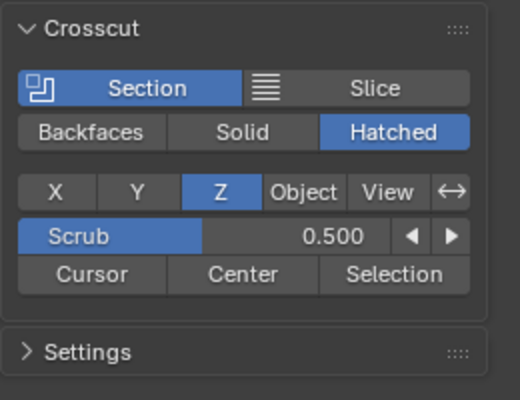

# Crosscut user guide

Crosscut cuts the 3D viewport with a plane and fills the cut faces, so cut parts read as
solid. It uses the same viewport clipping as Blender's Alt+B, so selection, snapping and
everything else in the view respect the cut. Nothing in your file changes except Crosscut's
own settings, which save with the scene.

Units below assume 1 Blender unit = 1 mm, but Crosscut works in any unit.

## Quick start

1. Open the sidebar (N) and pick the **Crosscut** tab.
2. Click **Section**. The plane starts in the middle of your parts and cuts away the half
   facing you.
3. Drag **Scrub** to sweep the plane through the parts.
4. Click **Section** again to turn it off.

## The main panel

### Section and Slice

- **Section** keeps one side of the plane: a half section.
- **Slice** keeps only what is near the plane. With **Thickness** 0 you see just the
  cross-section itself; with a thickness you see a slab, centred on the plane.
- Neither on: Crosscut does nothing of its own, but still caps Blender's Alt+B box (see
  below).

Clicking the lit button turns Crosscut off. Turning it off removes all clipping from the view,
including an Alt+B box that was there before.

### Cap style

- **Backfaces**: no caps, the plain Alt+B look. A zero-thickness slice still shows the
  section, in the theme's backface colour, since otherwise there would be nothing to see.
- **Solid**: the cut is filled with a flat colour.
- **Hatched**: filled and hatched, like a section drawing.

The cap style applies to Section, Slice and Alt+B alike.

### Plane

- **X / Y / Z**: the plane is perpendicular to that world axis.
- **Object**: the plane is the chosen object's local XY plane, through its origin. Move and
  rotate the object to move the plane. If only one Empty, or only one object, is visible when
  you choose Object, it is picked for you; if the chosen object has since been hidden or
  deleted, choosing Object picks again. **+** adds an Empty facing the view. Nothing is cut
  until an object is chosen. A part can be its own plane and is still capped; a flat mesh used
  as the plane is not.
- **View**: the plane faces the view as it is when you click. It stays where it is when you
  orbit; click **View** again to face the current view. Scrubbing moves it toward or away
  from you.
- **Flip** (Section only) keeps the other side.

Switching to another plane starts it in the middle of the scrub range (or through the Empty,
for an Object plane).

### Scrub

- **Scrub** sweeps the plane across the scrub range from 0 to 1. With **Scrub by Distance**
  (Settings) it shows the position as a distance instead: the world coordinate for X / Y / Z,
  the distance from the object's origin for Object, and from where it was placed for View.
- The arrows, and **Shift+Alt+Wheel** in the viewport, move the plane by one **Step**
  (Settings; default 0.08, one MJF layer). Hold Ctrl as well for 10 steps.
- **Cursor**, **Center** and **Selection** put the plane through the 3D cursor, the middle of
  the range, or the selection (selected vertices in Edit Mode).

## Settings panel

Everything beyond the main controls lives in the **Settings** panel below the main one,
closed by default.

- **Readout**: plane position and warnings in the viewport's bottom-left corner.
- **Scrub by Distance** and **Step**: see Scrub above.

### Caps

- **Colors**:
  - **Auto** follows the viewport's Solid colour setting (Object or Material colour). White
    or grey parts get the **Cap Color** instead, so the cut stands out; the Cap Color only
    shows in the panel when a part uses it.
  - **Object**, **Material**: the object's or first material's viewport colour.
  - **Palette**: a distinct colour per part.
  - **Single**: the Cap Color everywhere.
- **Hatching** (Hatched only):
  - **Hatch Space**: **Model** keeps the spacing in scene units, locked to the part. **Screen**
    keeps it in pixels at any zoom.
  - **Spacing**, **Angle** and **Line Width** set the lines.
  - **Vary per Object** alternates direction, then spacing, between parts, so touching
    sections stay distinguishable.
- **Outline** draws the cut contour. An orange outline means the mesh is open
  (non-manifold) there; the readout names the part. Selected parts' contours are drawn in the
  theme's selection colours (when the viewport shows selection outlines), whether or not
  Outline is on.
- **Overlaps**: where parts' sections overlap, **Blend** mixes their colours equally, and
  **Stripes** gives each part an equal share of stripes (**Stripe Width** in the hatch space).

#### Interference

With the header checkbox on, overlapping sections are highlighted. You can set the **Style**
(Solid, Hatched, Cross), **Color**, **Line Color** and **Opacity**. Below full opacity, the
blended or striped overlap shows through.

### Plane

- **Display**: None, Frame, Tint or Hatched.
- **Color** sets its colour, and **Second Plane** the colour of a slab's other plane.
- **Opacity** sets the tint (default 3 %; the slider goes to 10 %, type a value for more).
  Looking through both planes of a slab doesn't double the tint.

### Cap Targets

Which parts get caps: all **Visible** solids, only **Selected** ones (everything is still
clipped), or a **Collection**. Objects displayed as Wire or Bounds are never capped; the panel
and readout list any that are visible.

### Scrub Range

What Scrub sweeps across: the **Targets**' bounds, or an **Object**'s bounds, such as a build
volume. The eyedropper uses the active object. The range object is never capped, and with
it the readout counts steps (for example `step 150 / 1500`).

## Alt+B

Blender's own clipping box gets caps too, in the current cap style (Backfaces turns this
off). Pressing Alt+B while Crosscut is on gives clipping back to Blender and turns Crosscut
off. Clicking Section or Slice while an Alt+B box is on replaces it.

## Selecting in a zero-thickness slice

Blender can't select clipped geometry, and a zero-thickness slice clips everything. Crosscut
handles the click itself there: click a section to select its part, Shift+click to add or
remove it, and click again where parts overlap to cycle through them. Clicks on empty space go
to Blender as usual. Selected parts show their contour in the selection colour. Box select
doesn't work in this mode.

## Pie menu (Shift+Alt+B)

Section X / Y / Z, On/Off, Backfaces/Caps, Section/Slice, Flip, and Section from View.

## Limits

- Caps show in Solid shading only. Wireframe is clipped but not capped, and Blender doesn't
  clip Material Preview or Rendered views.
- Caps need closed meshes to be exact. Open meshes get a best-effort fill and an orange
  outline.
- One plane (two for a slab). A section box and multiple planes are on the roadmap
  ([Issues](https://github.com/calvin-young/blender-crosscut/issues)).
