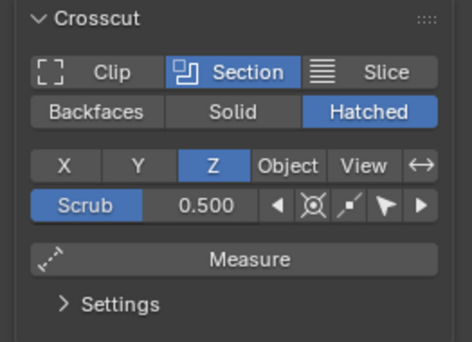

# Crosscut user guide

Crosscut cuts the 3D viewport with a plane and fills the cut faces, so cut parts read as
solid. It uses the same viewport clipping as Blender's clipping region, so selection, snapping and
everything else in the view respect the cut. Nothing in your file changes except Crosscut's
own settings, which save with the scene.

Units below assume 1 Blender unit = 1 mm, but Crosscut works in any unit.

## Quick start

1. Open the sidebar (N) and pick the **Crosscut** tab.
2. Click **Section**. The plane starts in the middle of your parts and cuts away the half
   facing you.
3. Drag **Scrub** to sweep the plane through the parts.
4. Click **Section** again to turn it off.

## The main panel

### Section and Slice

- **Section** keeps one side of the plane: a half section.
- **Slice** keeps only what is near the plane. With **Slice Thickness** 0 (Settings > Section/Slice Plane) you see just the
  cross-section itself; with a thickness you see a slab, centred on the plane.
- **Clip** is Blender's own clipping region, with caps (see below). The button is lit while the view
  has a box. Click it to turn Section or Slice off and bring back the box they replaced, or draw a new
  one; click it when lit to remove the box.

Clicking a lit Section or Slice turns Crosscut off. Turning it off removes all clipping from the
view, including a clipping region that was there before. With everything off, **X**, **Y**, **Z**,
**Object** and **View** each start the plane they name, in the last mode you used. Clicking the lit one
turns it off again.

### Cap style

- **Backfaces**: no caps, the plain clipping look. A zero-thickness slice still shows the
  section, in the theme's backface colour, since otherwise there would be nothing to see.
- **Solid**: the cut is filled with a flat colour.
- **Hatched**: filled and hatched, like a section drawing.

The cap style applies to Clip, Section and Slice alike.

### Plane

- **X / Y / Z**: the plane is perpendicular to that world axis.
- **Object**: the plane is perpendicular to one of the chosen object's local axes (**X**, **Y**
  or **Z** in the row below, Z by default), through its origin. Move and rotate the object to
  move the plane. When you choose Object it picks the only visible Empty, else the selected
  object, else the only visible object; if the chosen object has since been hidden or deleted,
  choosing Object picks again. **+** adds an Empty facing the view. Nothing is cut until an
  object is chosen. A part can be its own plane and is still capped; a flat mesh used
  as the plane is not.
- **View**: the plane faces the view as it is when you click. It stays where it is when you
  orbit. Scrubbing moves it toward or away
  from you.
- **Flip** (Section only) keeps the other side.

Switching to another plane starts it in the middle of the scrub range (or through the Empty,
for an Object plane).

### Scrub

- **Scrub** sweeps the plane across the scrub range from 0 to 1. With **Scrub by Distance**
  (Settings > Section/Slice Plane) it shows the position as a distance instead: the world coordinate for X / Y / Z,
  the distance from the object's origin for Object, and from where it was placed for View.
- The arrows, and **Shift+Alt+Wheel** in the viewport, move the plane by one **Step**
  (Settings > Section/Slice Plane; default 0.08, one MJF layer). Hold Ctrl as well for 10 steps.
- The small buttons between the arrows put the plane through the 3D cursor, the middle of the range
  (0.5), or the selection (selected vertices in Edit Mode).

## Settings panel

Everything beyond the main controls lives in the **Settings** panel below the main one,
closed by default.

- **Readout**: plane position and warnings at the bottom centre of the viewport. It hides with
  overlays (Alt+Shift+Z), as the plane does.
- **Face Orientation**: the viewport's own overlay, here so you can check it's on. With it on, a cap
  seen from inside a part draws in the backface colour.
- **Clip Tint**: see Clipping region.

### Cut Faces

The faces Crosscut fills where the plane cuts a part (its "caps").

- **Fill**: which parts get filled: **Visible Objects**, **Selected Objects** (everything is still clipped)
  or a **Collection**. Objects displayed as Wire or Bounds are never capped; the panel and readout list
  any that are visible.
- **Colors**:
  - **Auto** follows the viewport's Solid colour setting (Object or Material colour). White
    or grey parts get the **Fill Color** instead, so the cut stands out; the Fill Color only
    shows in the panel when a part uses it.
  - **Object**, **Material**: the object's or first material's viewport colour.
  - **Palette**: a distinct colour per part.
  - **Single**: the Fill Color everywhere.
- **Saturation**, **Brightness** and **Tint** adjust colors that come from the parts (not the Fill Color). A filled cut
  face has no lighting, so by default these sit a little grayer and darker than the part's own color.
- **Fill Opacity** applies to every filled cut face.
- **Hatching** (Hatched only):
  - **Hatch Space**: **Model** keeps the spacing in scene units, locked to the part. **Screen**
    keeps it in pixels at any zoom.
  - **Spacing**, **Angle** and **Line Width** set the lines. In Model space, **Scale with Part** makes
    spacing follow each part's size; Spacing is then what a 50 unit part gets.
  - **Vary per Object** alternates direction, then spacing, between parts, so touching
    sections stay distinguishable. Each part keeps its variation when others are hidden, shown
    or added.
- **Outline** draws the cut contour. Selected parts' contours are drawn in the
  theme's selection colours (when the viewport shows selection outlines), whether or not
  Outline is on.
- **Overlaps**: where parts' sections overlap, **Blend** mixes their colours equally, **Stripes** gives
  each part an equal share of stripes (**Stripe Width** in the hatch space), and **Highlight** marks them,
  in a **Style** (Solid, Hatched, Cross), **Color**, **Line Color** and **Opacity** you set. Below full
  opacity, the blended overlap shows through.
- **Open Part Opacity**: the cap's opacity on a part with holes in its mesh, since its cut may not
  show real material (default 50 %). The readout warns in amber when a cut goes through such a
  part, and in red when the hole is on the plane itself, where the gaps get closed by guesswork.
- The readout also names parts that are **inside out**, in red, and parts with **flipped faces**, in
  amber. Flipped faces make overlapping shells inside a part show as holes.

In X-ray (Alt+Z) caps follow the viewport's X-ray opacity, and nothing hides them or their
contours.

### Section/Slice Plane

- **Scrub Range** is what Scrub sweeps across: the **Fill Targets**' bounds, or an **Object**'s bounds, such as a
  build volume. The eyedropper uses the active object. The range object is never capped, and with it
  the readout counts steps (for example `step 150 / 1500`).
- **Scrub by Distance** and **Step**: see Scrub above.
- **Display**: None, Frame, Tint or Hatched.
- **Color** sets its colour, and **Second Plane** the colour of a slab's other plane.
- **Opacity** sets the tint (default 3 %; the slider goes to 10 %, type a value for more).
  Looking through both planes of a slab doesn't double the tint.

## Print Preview (experimental)

Tick **Print Preview** in **Settings** while Section or Slice is on, with the Z plane and a build volume as the Scrub Range object. The bed fills with
powder up to the plane, the parts below are buried in it, and each part's cut is drawn as the
fused layer. Scrub to watch the build come up layer by layer; the readout counts layers at the
Step size. **Slice** shows one layer of powder (a band, with Slice Thickness), not the whole bed. **Powder** and **Fused** set the colours (white and black by default, as on a
Multi Jet Fusion printer), **Grain** the speckle in the powder. Without a Scrub Range object the
bed is the parts' bounds plus **Bed Margin**.

## Clipping region

**Clip** is Blender's own clipping region (the Alt+B shortcut works too). It gets caps in the current
cap style (Backfaces turns this off). Pressing Alt+B while Section or Slice is on gives clipping back to
Blender and turns them off. Clicking Section or Slice while a clipping region is on replaces it, and
clicking **Clip** brings that box back, until you close the file. Clicking Clip while it's lit removes
the box for good, so the next click draws a new one.

With Clip on, two **Scrub** sliders slide the box through the parts without changing its size, one per
axis, each labelled with the world axis it's closest to. Each has its own step arrows.
**Shift+Alt+Wheel** uses the axis facing you most. At 0 and 1 the box is just clear of the Scrub
Range. **Scrub by Distance** shows where the box's middle is, as a distance.

**Clip Tint** in Settings shows the region's volume as a faint tint on the background. Blender's own tint
is always removed, since it can't follow the box; Crosscut's follows it.

## Measure

Click **Measure**, then hover over a cut. It runs until you click it again or press Esc, and either clears
any pinned lines.

- Over one part, a line shows the section's thickness at the mouse, straight across from the nearest wall.
- Over an overlap, a line shows the overlap's width at the mouse, from one part's edge to the other's, and a
  second line shows its greatest width anywhere (labelled "max"), which can be away from the mouse. Where more
  than two parts overlap, it measures the first two. A very long, thin overlap can read as several short ones:
  hover over its deepest part.

To get the exact line you want, click a showing line: the end nearer the mouse stays put, and moving the mouse
swings the line around that end, with the other end following the section's edges. Click again to pin it, and carry on to measure and pin more. Esc while
placing a line drops just that one. Pinned lines stay where they are if you move a part or the plane.

In Settings > Measure:

- **Local Width**: the line at the mouse, and its color.
- **Overlap Max**: the "max" line over an overlap, and its color.
- **Section Max**: over one part, a "max" line too, at the section's thickest place. Off by default.
- **Ignore Overlaps**: always measure one part's thickness, even over an overlap. Off by default.
- **Text Size** of the lengths.

## Selecting in a zero-thickness slice

Blender can't select clipped geometry, and a zero-thickness slice clips everything. Crosscut
handles the click itself there: click a section to select its part, Shift+click to add or
remove it, and click again where parts overlap to cycle through them. Clicks on empty space go
to Blender as usual. Selected parts show their contour in the selection colour. Box select
doesn't work in this mode.

## Pie menu (Shift+Alt+B)

Section X / Y / Z, On/Off, Backfaces/Caps, Section/Slice, Flip, and Section from View.

## Painting and selecting with a cut on

Weight painting and other tools work on what's kept, and not on what's cut away. Outside Object Mode, Blender's
faint tint shows on the background while a cut is on: the tools rely on the same box that makes it.

## Limits

- Caps show in Solid shading only. Wireframe is clipped but not capped, and Blender doesn't
  clip Material Preview or Rendered views.
- Caps need closed meshes to be exact. Open meshes get a best-effort fill and a red
  outline.
- One plane (two for a slab). A section box and multiple planes are on the roadmap
  ([Issues](https://github.com/calvin-young/blender-crosscut/issues)).
